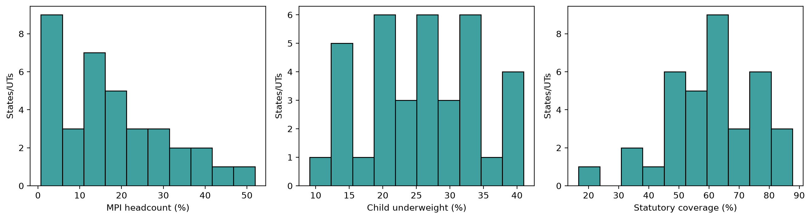
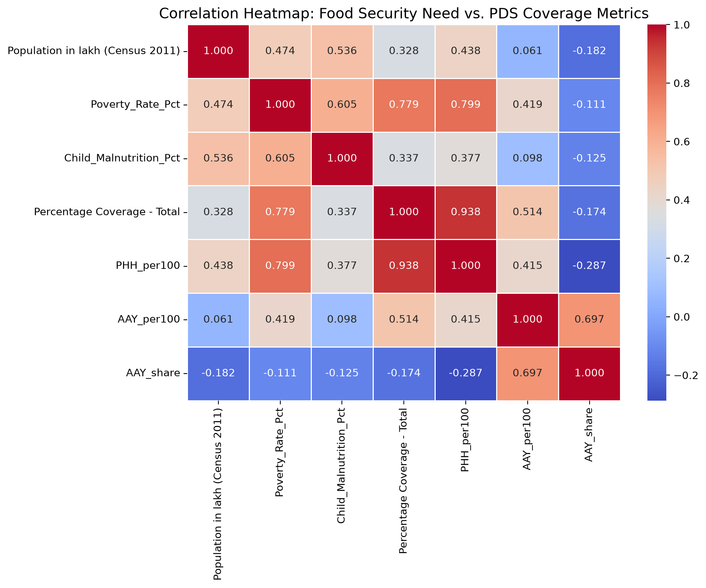
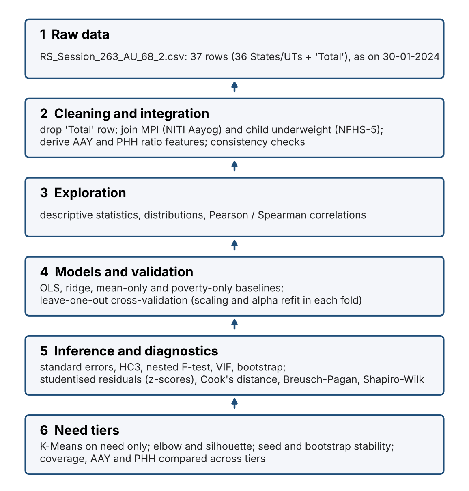
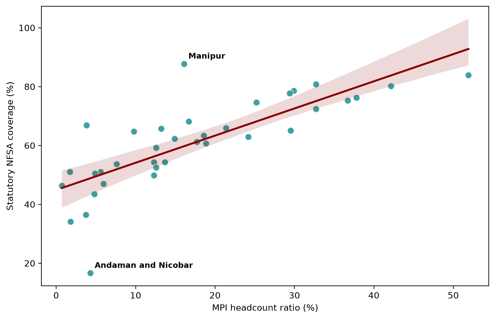
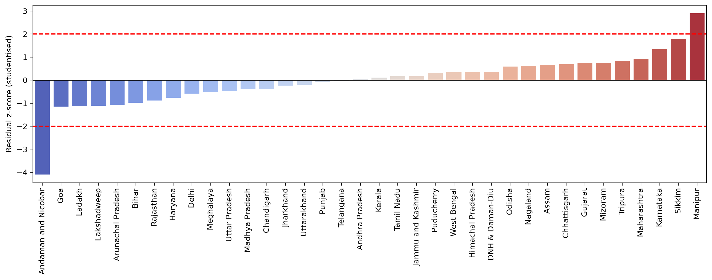
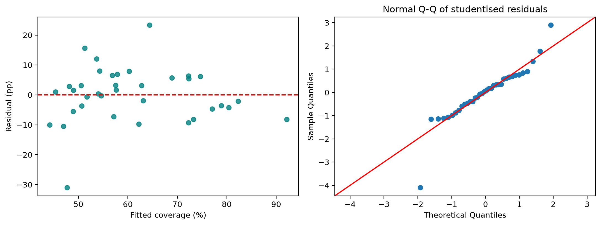
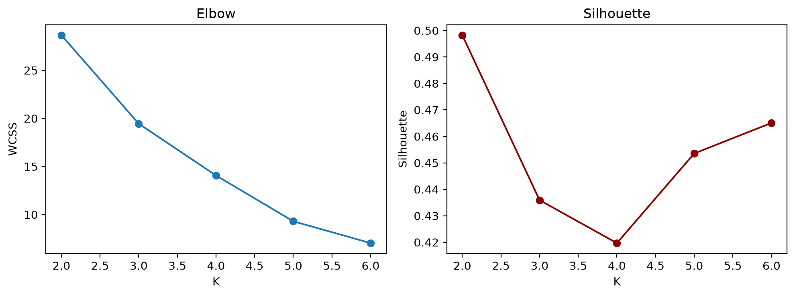
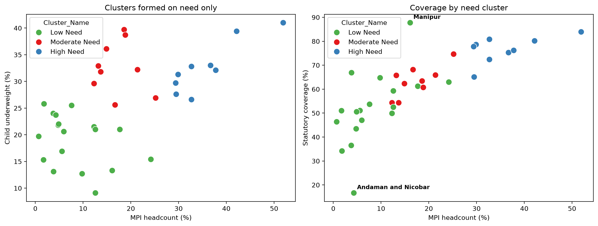

<h1 class="title">Is Food-Security Coverage Matched to Need?
 
 
Evidence from NFSA Antyodaya and Priority-Household Allocations Across Indian States and Union Territories: A Regression and Clustering Case Study
</h1>

Lakshay

Department of Computer Science, Ramanujan College, University of Delhi, New Delhi, India

Roll No.: 24570034 / 24020570034 

| Problem No.: 43 | Subject: Machine Learning (B.Sc. (H) Computer Science, Semester V) | Supervisor: Nikhil Rajput | Article type: Short Communication (welfare-targeting evidence note)

**Abstract.** The National Food Security Act (NFSA), 2013 fixes, for every State and Union Territory (UT), the share of the 2011 population entitled to subsidised grain as Antyodaya Anna Yojana (AAY) or Priority Household (PHH) beneficiaries. This short communication asks whether these statutory shares are matched to socioeconomic need. We combine the Rajya Sabha coverage table (data as on 30 January 2024) for 36 States/UTs with the NITI Aayog multidimensional poverty (MPI) headcount ratio and NFHS-5 child underweight prevalence, and derive AAY and PHH ratio features. Models are scored by leave-one-out cross-validation against a mean-only baseline. MPI headcount alone predicts total coverage out of sample (R² = 0.559, RMSE = 10.0 percentage points, against −0.058 and 15.5 for the baseline): one more MPI point is associated with 0.92 more points of coverage (95% CI 0.66 to 1.18). Child underweight adds nothing once MPI is included (nested F-test p = 0.118), and ridge regression matches OLS. PHH coverage tracks poverty closely (leave-one-out R² = 0.59), whereas AAY coverage barely does (0.09). Residual z-scores flag two units on total coverage: Andaman and Nicobar (z = −4.1; 16.7% actual vs 47.7% predicted) and Manipur (z = +2.9; 87.7% vs 64.4%); Bihar's shortfall of 8.2 points is within ordinary scatter (z = −0.99). K-Means on need alone yields three tiers whose mean coverage rises from 52.0% to 63.3% to 76.7% (Kruskal–Wallis p < 0.001), but the partition is only moderately stable (silhouette 0.436 at K = 3 against 0.498 at K = 2). The analysis is correlational, rests on 36 aggregate units, and treats residuals as deviations from a cross-state pattern, not as proof of unmet need.

**Keywords:** food security; National Food Security Act; Public Distribution System; AAY; PHH; Multidimensional Poverty Index; regression; ridge; k-means; leave-one-out cross-validation; SDG 1; SDG 2; SDG 10

## 1 Introduction

Undernutrition and poverty remain central development challenges, and the United Nations 2030 Agenda addresses them through SDG 2 (Zero Hunger), linking them to SDG 1 (No Poverty) and SDG 10 (Reduced Inequalities) [1]. In India the largest public response is the Targeted Public Distribution System (TPDS) under the National Food Security Act (NFSA), 2013 [2]. At the all-India level the Act entitles up to 75% of the rural and 50% of the urban population to subsidised foodgrain. Eligible households are either Antyodaya Anna Yojana (AAY) households, the poorest, who receive 35 kg per household per month, or Priority Households (PHH), who receive 5 kg per person per month [2, 3]. In the dataset used here the accepted coverage totals 81.35 crore persons, 67.2% of the 2011 Census population.

The State-wise coverage shares were determined by the erstwhile Planning Commission from NSS household consumption data for 2011–12 [3]. They are therefore historical allocations that predate the National MPI used in this study, and they are bounded by a national quota, so a larger share for one State implies a smaller share elsewhere. Whether this allocation pattern still tracks need is an empirical question that can be examined with current subnational indicators: how much of the cross-state variation in statutory coverage can be anticipated from poverty and child undernutrition, and which States deviate most?

This paper treats NFSA coverage across Indian States and UTs as a single case and asks four questions. **RQ1:** How well do MPI headcount and child underweight predict a State's statutory coverage out of sample? **RQ2:** Which of the two indicators carries the signal? **RQ3:** Do the AAY and PHH tiers track need equally? **RQ4:** Which States/UTs deviate from the cross-state pattern, and do States/UTs fall into need tiers whose coverage differs? We use classical methods from an undergraduate syllabus (OLS, ridge regression, residual analysis and k-means) and, because only 36 units are available, evaluate them by leave-one-out cross-validation against explicit baselines. The study is a case study rather than a general method paper: one country, one administrative table, and an emphasis on describing what the data do and do not support.

Our contributions are: (i) a documented integration of an administrative coverage table with two independent need indicators, including consistency checks on the source table; (ii) a validated comparison of OLS, ridge and baseline models with inference, diagnostics and a bootstrap; (iii) a separate analysis of AAY and PHH ratio features, which shows that the two tiers behave differently; (iv) residual z-score flagging with a robustness check; and (v) k-means clustering on need alone with an honest assessment of cluster quality and stability. Section 2 reviews related work, Section 3 the data, Sections 4 and 5 the methods and setup, Section 6 the results and Section 7 the discussion.

## 2 Related Work

**Targeting and the PDS.** A long literature examines how well India's Public Distribution System reaches the poor, focusing on leakages and on inclusion and exclusion errors in identifying beneficiaries. Khera, for example, documents trends in the diversion of PDS grain across States [11], and Drèze and Sen discuss public provisioning and undernutrition in India more broadly [10]. That literature mostly studies households or the leakage of grain. We instead study the State-level allocation of statutory coverage, a prior stage, and ask whether it lines up with current indicators of need.

**Measuring need.** NITI Aayog's National MPI follows the Alkire–Foster counting method [9], combining health, education and living-standard deprivations. Its baseline edition uses NFHS-4 (2015–16) [5], and an NFHS-5-based update exists [6]. Child underweight from NFHS-5 [7] offers a second, nutrition-specific indicator. Because the MPI's health dimension includes nutrition, the two indicators are expected to overlap, which makes the question of whether underweight adds anything a real test (Section 6.2).

**Evaluation with few observations.** With 36 units a single train–test split is unstable. Leave-one-out cross-validation is a standard alternative for small samples [13, 14], provided that scaling and tuning are repeated inside each fold. Ridge regression [15] addresses collinearity by shrinking coefficients, and influence and residual diagnostics [16–19] are the standard tools for deciding whether a few units drive a fit. Because the data are State-level aggregates, associations cannot be transferred to households (the ecological fallacy [12]). Clustering uses Lloyd's algorithm [21] with k-means++ seeding [22] and is judged by the silhouette [23, 24] and by the adjusted Rand index [25] across restarts and resamples. All models are implemented with scikit-learn [27] and statsmodels [28]; algorithm descriptions follow [14].

## 3 Dataset and Preprocessing

### 3.1 Sources and description

The coverage table is the Rajya Sabha answer to Unstarred Question No. 68 (Session 263), published on the Open Government Data (OGD) Platform India as *States/UT-wise Beneficiaries covered under Antyodaya Anna Yojana (AAY) and Priority Households (PHH) as on 30-01-2024* [4]. The file has 37 rows and 16 columns: 36 States/UTs and a "Total" row. Two independent need indicators were added for each State/UT (Table 1).

**Table 1:** Variables, content and sources.

| Variable | Content | Source | Reference period |
| --- | --- | --- | --- |
| Total coverage (%) | NFSA accepted persons as % of 2011 Census population | Rajya Sabha, Session 263, Unstarred Q. 68, via OGD India [4] | As on 30-01-2024; population from Census 2011 |
| AAY persons and families; PHH persons | Present coverage, in lakh | Same table [4] | As on 30-01-2024 |
| MPI headcount ratio (%) | Share of the population that is multidimensionally poor | NITI Aayog National MPI Baseline Report [5] | NFHS-4, 2015–16 |
| Child underweight (%) | Children under 5 years underweight (weight-for-age) | NFHS-5 fact sheets [7], as tabulated in Economic Survey 2021-22, Table 8.17 [8] | NFHS-5, 2019–21 |

### 3.2 Cleaning and integration

State/UT names were trimmed of stray whitespace and checked for duplicates, and all numeric columns were verified to be numeric. The "Total" row repeats the 36 units (population 12,103.22 lakh in both; accepted persons 8,134.91 lakh against a unit sum of 8,134.94 lakh) and was dropped to avoid double counting, leaving N = 36. No values were missing and none were imputed. An outer join confirmed that every name matched across the coverage table and the need indicators.

A few units needed documented adjustments. The MPI baseline reports Dadra and Nagar Haveli (27.36%) and Daman and Diu (6.82%) separately, so the merged union territory was assigned their Census-2011 population-weighted mean (18.85%). It reports Jammu and Kashmir and Ladakh together (12.58%), and that value was used for both, while the NFHS-5 underweight figure is for Jammu and Kashmir excluding Ladakh. Goa's and Chandigarh's MPI values were set to the published 3.76% and 5.97%. The need indicators were transcribed from the published tables; 20 State MPI values and Ladakh's underweight value are still to be cross-checked against the primary tables (Section 7, limitation viii).

### 3.3 Ratio features and consistency checks

The problem statement asks for AAY and PHH coverage to be compared separately, so three ratio features were derived: *AAY per 100* (AAY persons per 100 population), *PHH per 100* (priority-household persons per 100 population), and *AAY share* (AAY persons as a percentage of AAY plus PHH persons). Total coverage recomputed as accepted persons over 2011 population agrees with the published percentage to within 0.21 percentage points (the largest gap is in a very small UT, where counts are rounded to 0.01 lakh), and AAY plus PHH persons equal total present persons to within 0.01 lakh.

Two data-quality points matter for interpretation. The implied number of persons per AAY family ranges from 2.46 to 5.00, and Bihar sits at exactly 5.00 (125.05 lakh persons for 25.01 lakh families), which suggests that AAY person counts are administrative conversions from families in at least that unit rather than head counts. Chandigarh publishes 0.00 lakh AAY families and 0.01 lakh AAY persons, so its AAY ratios are coarse. The source also marks Chandigarh and Puducherry as direct-benefit-transfer (DBT) units, where benefits are delivered differently.

### 3.4 Descriptive picture

**Table 2:** Descriptive statistics for the 36 States/UTs.

| Variable | N | Mean | SD | Min | Median | Max |
| --- | --- | --- | --- | --- | --- | --- |
| MPI headcount (%) | 36 | 17.44 | 12.90 | 0.71 | 14.30 | 51.91 |
| Child underweight (%) | 36 | 25.82 | 8.36 | 9.10 | 25.70 | 41.00 |
| Total coverage (%) | 36 | 60.98 | 15.28 | 16.65 | 62.63 | 87.74 |
| PHH persons per 100 pop. | 36 | 51.44 | 14.13 | 12.11 | 52.52 | 71.88 |
| AAY persons per 100 pop. | 36 | 7.14 | 3.07 | 0.09 | 7.38 | 12.59 |
| AAY share of covered (%) | 36 | 12.36 | 5.43 | 0.33 | 11.35 | 26.77 |
| Population (lakh) | 36 | 336.20 | 430.14 | 0.64 | 210.53 | 1995.81 |

Statutory total coverage ranges from 16.65% (Andaman and Nicobar) to 87.74% (Manipur), with a mean of 61.0%. The MPI headcount ranges from 0.71% (Kerala) to 51.91% (Bihar), and child underweight from 9.1% (Ladakh) to 41.0% (Bihar). PHH coverage runs from 12.1 to 71.9 persons per 100 population and AAY coverage from 0.09 (Chandigarh) to 12.59 (Tripura). Total coverage is strongly associated with MPI (Pearson r = 0.779; Spearman ρ = 0.836, so the association is not an artefact of a few extreme values) and more weakly with child underweight (r = 0.337; ρ = 0.435). The two need indicators correlate at r = 0.605 (ρ = 0.635). By tier, MPI correlates with PHH per 100 at r = 0.799, with AAY per 100 at r = 0.419, and with the AAY share at r = −0.111. Population correlates with total coverage at only r = 0.328.

 

*Figure 2: Distributions of MPI headcount, child underweight and statutory coverage across the 36 States/UTs.*
 

*Figure 3: Correlation matrix of population, need indicators, total coverage and the AAY/PHH ratio features.*

## 4 Methodology

Fig. 1 summarises the workflow. All preprocessing that depends on the data (standardisation and the ridge penalty search) is repeated inside every cross-validation fold, so no information from the held-out State/UT reaches the model that predicts it.

*Figure 1: Methodology pipeline used in this study.*

### 4.1 Outcomes and predictors

The primary outcome is total statutory coverage Y (% of the 2011 population). Three secondary outcomes use the ratio features: PHH persons per 100 population, AAY persons per 100 population, and the AAY share of covered persons. The predictors are the MPI headcount ratio (X1) and child underweight (X2). A robustness variant adds log population.

### 4.2 Models and baselines

The two-predictor OLS model is given in Eq. (1). Ridge regression minimises the penalised objective in Eq. (2), with the predictors standardised to zero mean and unit variance (Z) [15].

\[
{ \boldsymbol{Y_i = \beta_0 + \beta_1\,\textbf{MPI}_i + \beta_2\,\textbf{UW}_i + \varepsilon_i}} 
\]

 
 
\[
{ \boldsymbol{\min_{\beta}\ \sum_{i=1}^{n}\Big(Y_i - \beta_0 - \sum_{j=1}^{2}\beta_j Z_{ij}\Big)^{2} + \alpha \sum_{j=1}^{2}\beta_j^{2}}}
\]
 
Two baselines are used: a mean-only predictor, which by construction has leave-one-out R² slightly below zero, and a poverty-only OLS model. Ridge is run with α = 1.0 and with α tuned by cross-validation.

### 4.3 Validation

With N = 36, every model is scored by leave-one-out cross-validation (LOOCV): each State/UT is predicted by a model fitted on the other 35. We report the pooled R² of Eq. (3), RMSE and MAE in percentage points, and, for comparison only, in-sample values.

\[
{\boldsymbol{R^{2} = 1 - \frac{\sum_{i}\left(y_i - \hat{y}_i\right)^{2}}{\sum_{i}\left(y_i - \bar{y}\right)^{2}}}} 
\]

### 4.4 Inference and diagnostics

Coefficients are reported with OLS standard errors, confidence intervals and HC3 heteroscedasticity-robust p-values [19]. A nested F-test compares the poverty-only model with the two-predictor model, and with two predictors the variance inflation factor is given by Eq. (4). A bootstrap of 2,000 resamples compares the variability of the standardised OLS and ridge coefficients.
 

\[
{\boldsymbol{\textbf{VIF} = \frac{1}{1 - r^{2}}}} 

\]
 
 

Residual z-scores are studentised residuals, defined in Eq. (5), where e\_i is the residual, s\_(i) the residual standard deviation without unit i and h\_ii its leverage; a unit is flagged when |t\_i| > 2.
 
 
\[
{\boldsymbol{t_i = \frac{e_i}{s_{(i)}\sqrt{1 - h_{ii}}}}} \tag{5}
\]
 

Influence is measured by Cook's distance (rule of thumb 4/n) [16], and residuals are checked with the Breusch–Pagan test for equal variance [17] and the Shapiro–Wilk test for normality [18].
 
### 4.5 Clustering need tiers

States/UTs are clustered with k-means on standardised MPI and child underweight only. Coverage is deliberately excluded so that it can be compared across tiers without circularity. K-means minimises the within-cluster sum of squares in Eq. (6) [21].

\[
{\boldsymbol{\textbf{WCSS} = \sum_{k=1}^{K}\sum_{z \in C_k}\left\lVert z - \mu_k \right\rVert^{2}}}
\]

 
The number of clusters K = 2,…,6 is examined with the elbow and with the silhouette of Eq. (7) \[23\], where a(i) and b(i) are the mean distances to the own and the nearest other cluster.
 
 
\[
{\boldsymbol{s(i) = \frac{b(i) - a(i)}{\max\{a(i),\, b(i)\}}}} \tag{7}
\]
 
 
K = 3 was specified in advance to give Low, Moderate and High need tiers. Stability is measured by the adjusted Rand index (ARI) \[25\] across 30 single-start random seeds and 200 bootstrap resamples. Tier differences in coverage are tested with the Kruskal–Wallis test \[26\].

## 5 Experimental Setup

**Tuning and settings.** The ridge penalty was tuned over 60 values between 10⁻³ and 10³ by leave-one-out cross-validation; the selected value on the full data is α = 1.80 (Table 3). No other hyper-parameters were tuned.

**Table 3:** Settings used in the experiments.

| Component | Setting |
| --- | --- |
| Ridge regression | α = 1.0 (fixed) and α tuned by LOO-CV over 60 values in \[10⁻³, 10³\] (selected α = 1.80) |
| Validation | Leave-one-out; scaling and α search refitted in each fold |
| K-Means | K = 3 pre-specified; K = 2 to 6 examined; k-means++ initialisation; 50 restarts; seed 42 |
| Bootstrap | 2,000 resamples (OLS vs ridge coefficients); 200 resamples (cluster stability) |
| Flag thresholds | \|studentised residual\| > 2; Cook's distance > 4/n |

 

**Environment.** Python 3 notebook (Google Colab) with pandas, NumPy, SciPy, scikit-learn, statsmodels, seaborn and Matplotlib; random seed 42. The notebook `Food_829a36.ipynb` regenerates every number, table and figure in this paper from the CSV file.

## 6 Results

### 6.1 Predicting total coverage

Table 4 gives the leave-one-out results. The mean-only baseline has R² = −0.058 and an RMSE of 15.5 points, whereas a model that uses only the MPI headcount cuts the RMSE by about a third to 10.0 points (R² = 0.559, MAE 6.87). The poverty-only model performs as well as the two-predictor OLS (R² = 0.556, RMSE 10.04, MAE 7.41), ridge with α = 1.0 (R² = 0.559, RMSE 10.00) and ridge with the tuned α = 1.80 (R² = 0.559, RMSE 10.00), and adding log population does not help (R² = 0.554, RMSE 10.07). The differences among these models are at most 0.07 points of RMSE, far below what 36 observations can resolve. In-sample figures overstate accuracy: the two-predictor OLS has an in-sample R² of 0.635 against a leave-one-out R² of 0.556.

**Table 4:** Leave-one-out and in-sample performance for total coverage (percentage points).

| Model | LOO R² | LOO RMSE | LOO MAE | In-sample R² | In-sample RMSE |
| --- | --- | --- | --- | --- | --- |
| Mean-only baseline | −0.058 | 15.496 | 12.244 | 0.000 | 15.066 |
| OLS: poverty only | 0.559 | 10.004 | 6.865 | 0.606 | 9.454 |
| OLS: poverty + underweight | 0.556 | 10.035 | 7.409 | 0.635 | 9.105 |
| OLS: poverty + underweight + log population | 0.554 | 10.066 | 7.664 | 0.657 | 8.821 |
| Ridge (α = 1.0) | 0.559 | 10.001 | 7.238 | 0.634 | 9.120 |
| Ridge (α tuned by LOO-CV) | 0.559 | 10.004 | 7.160 | 0.631 | 9.148 |

 

*Figure 4: MPI headcount ratio and statutory total coverage for the 36 States/UTs with the OLS line and 95% band; the two flagged units are labelled.*

### 6.2 Which indicator carries the signal?

In the two-predictor OLS (Table 5) the MPI coefficient is 1.07 points of coverage per MPI point (SE 0.16, 95% CI 0.76 to 1.39, p < 0.001), and the overall regression is significant (F = 28.7, p < 0.001; R² = 0.635, adjusted R² = 0.613). Child underweight has a small negative, non-significant coefficient (−0.39, SE 0.24, p = 0.118; HC3 p = 0.219). A nested F-test confirms that it adds nothing beyond poverty (F = 2.58, p = 0.118). The poverty-only model has the slightly higher leave-one-out R² (0.559 against 0.556), whereas the larger model has the marginally higher adjusted R² (0.613 against 0.595); neither difference is meaningful with 36 observations. In the poverty-only model one more MPI point is associated with 0.92 more points of coverage (95% CI 0.66 to 1.18). The negative sign on underweight should not be read as evidence that undernutrition lowers coverage; it reflects conditioning on an overlapping indicator.

**Table 5:** OLS coefficients for total coverage (percentage points).

| Term | Coef | SE | t | p | p (HC3) | CI low | CI high |
| --- | --- | --- | --- | --- | --- | --- | --- |
| Intercept | 52.243 | 5.313 | 9.833 | < 0.001 | < 0.001 | 41.434 | 63.052 |
| MPI headcount (pp) | 1.074 | 0.157 | 6.864 | < 0.001 | < 0.001 | 0.756 | 1.393 |
| Child underweight (pp) | −0.388 | 0.241 | −1.605 | 0.118 | 0.219 | −0.879 | 0.104 |

The correlation between the two indicators is 0.605, so the variance inflation factor is 1.58, well below the usual thresholds of 5 to 10: collinearity is low to moderate in these data, and the case for ridge regression is correspondingly weak. Per standard deviation of the predictors (one SD of MPI is 12.7 points) the OLS coefficients are 13.66 for MPI and −3.19 for underweight, and the ridge coefficients with α = 1.0 are 13.02 and −2.73. The bootstrap [20] (Table 6) shows that ridge reduces the sampling variability of the coefficients by only about 8% (bootstrap SD 2.02 against 2.19 for MPI, and 2.14 against 2.32 for underweight). Ridge is therefore harmless but unnecessary here.

**Table 6:** Bootstrap comparison (2,000 resamples) of standardised OLS and ridge (α = 1.0) coefficients.

| Coefficient | OLS estimate | OLS boot SD | OLS 95% CI | Ridge estimate | Ridge boot SD | Ridge 95% CI |
| --- | --- | --- | --- | --- | --- | --- |
| MPI (per SD) | 13.66 | 2.19 | \[10.1, 18.6\] | 13.02 | 2.02 | \[9.6, 17.4\] |
| Underweight (per SD) | −3.19 | 2.32 | \[−8.2, 0.7\] | −2.73 | 2.14 | \[−7.2, 0.9\] |

### 6.3 AAY and PHH separately

The two tiers do not track need equally (Table 7). PHH coverage is predicted almost as well as total coverage (leave-one-out R² = 0.59; each MPI point is associated with 0.88 more PHH persons per 100 population, 95% CI 0.65 to 1.10). AAY coverage is only weakly related to poverty (leave-one-out R² = 0.09; slope 0.10, CI 0.02 to 0.18), and the AAY share of covered persons has no out-of-sample predictive value at all (R² = −0.10 with MPI alone; slope −0.05, CI −0.19 to 0.10). Child underweight adds nothing for any outcome (nested p between 0.12 and 0.67). Total coverage is dominated by PHH persons, which is why the aggregate analysis mainly describes the PHH tier. A possible reason why AAY tracks poverty less closely is that it is counted in households against a fixed ceiling, but this explanation is not tested here, and the data-quality notes in Section 3.3 (person counts converted from families, coarse values for the smallest UTs) argue for caution with AAY person-based ratios.

**Table 7:** Leave-one-out R² and MPI slope for each outcome.

| Outcome | LOO R²: mean only | LOO R²: MPI only | LOO R²: MPI + underweight | MPI slope per point (95% CI) | Underweight adds (nested p) |
| --- | --- | --- | --- | --- | --- |
| Total coverage (% of population) | −0.06 | 0.56 | 0.56 | 0.92 (0.66 to 1.18) | 0.118 |
| PHH coverage (persons per 100 population) | −0.06 | 0.59 | 0.59 | 0.88 (0.65 to 1.10) | 0.198 |
| AAY coverage (persons per 100 population) | −0.06 | 0.09 | 0.09 | 0.10 (0.02 to 0.18) | 0.214 |
| AAY share of covered persons (%) | −0.06 | −0.10 | −0.14 | −0.05 (−0.19 to 0.10) | 0.674 |

### 6.4 Units outside the cross-state pattern

OLS with an intercept forces the residuals to sum to zero, so some units always lie above and some below the fitted relationship; a residual is a deviation from the cross-state average, not an absolute standard of need. The in-sample RMSE is 9.1 points, so a studentised residual of 2 corresponds to a gap of roughly 18 to 20 points. Two units exceed that threshold on total coverage (Table 8, Figure 5). **Andaman and Nicobar** has actual coverage of 16.65% against 47.68% predicted from its MPI of 4.3% (residual −31.03 points, z = −4.10, Cook's distance 0.26). **Manipur** has 87.74% against 64.39% predicted at an MPI of 16.1% (residual +23.35 points, z = +2.90, Cook's distance 0.31). Both exceed the Cook's distance rule of thumb of 4/n = 0.111. The next largest deviations are Sikkim (+15.6 points, z = +1.78) and Goa (−10.5 points, z = −1.15). Bihar, the highest-poverty unit (MPI 51.91%), has actual coverage of 83.92% against 92.14% predicted (residual −8.22 points, z = −0.99, Cook's distance 0.10), so its shortfall is inside the ordinary scatter around the line and the model does not single it out.

**Table 8:** States/UTs with residual z-score (studentised residual) outside ±2, by outcome (z in brackets).

| Outcome | Below the cross-state pattern (z < −2) | Above the pattern (z > 2) |
| --- | --- | --- |
| Total coverage (% of population) | Andaman and Nicobar (−4.1) | Manipur (+2.9) |
| PHH coverage (persons per 100 population) | Andaman and Nicobar (−3.9) | none |
| AAY coverage (persons per 100 population) | Chandigarh (−2.3); Rajasthan (−2.1) | Tripura (+2.1); Himachal Pradesh (+2.1) |
| AAY share of covered persons (%) | Chandigarh (−2.5) | Himachal Pradesh (+2.9); Andaman and Nicobar (+2.1) |

*Figure 5: Residual z-scores (studentised residuals) of total coverage by State/UT; dashed lines mark ±2.*

The tier results are consistent with this picture. Andaman and Nicobar's shortfall is a PHH shortfall (12.1 PHH persons per 100 population, the lowest of all units), and its high AAY share (z = +2.1) reflects that small PHH base rather than a large AAY coverage. Chandigarh's near-zero AAY coverage (0.09 per 100) is the coarse, direct-benefit-transfer case described in Section 3.3. Diagnostics do not suggest a problem with the model: the Breusch–Pagan test gives p = 0.384, and the Shapiro–Wilk test on the residuals gives p = 0.051, which is borderline. Refitting the poverty-only model without the two flagged units gives a slope of 0.85 and R² = 0.75 (N = 34), against 0.92 and 0.61 on the full sample, so the main conclusion does not depend on them.

*Figure 6: Residual diagnostics for total coverage: residuals against fitted values (left) and normal Q–Q plot of the studentised residuals (right).*

### 6.5 Need tiers

On standardised MPI and underweight, the silhouette is 0.498 at K = 2 and 0.436 at K = 3, with 0.420, 0.454 and 0.465 for K = 4, 5 and 6 (WCSS 28.7, 19.5, 14.1, 9.3, 7.0; Figure 7). By the usual reading of the silhouette [24], values between 0.26 and 0.50 indicate weak structure, so the three tiers (specified in advance) are a descriptive summary rather than evidence of natural groups. The partition is also only moderately stable: against the main solution, single-start runs from 30 random seeds have a mean ARI of 0.71 (minimum 0.35), and 200 bootstrap resamples have a mean of 0.76 (5th percentile 0.35). It differs from the design that also clustered on coverage (ARI 0.37), as expected when the outcome is removed from the clustering features.

*Figure 7: Elbow (within-cluster sum of squares) and silhouette for K = 2 to 6.*

Table 9 and Figure 8 profile the tiers. Mean total coverage rises from 52.0% in the low-need tier to 63.3% in the moderate tier and 76.7% in the high-need tier, a difference that is statistically detectable (Kruskal–Wallis p < 0.001), and PHH persons per 100 rise from 42.3 to 53.2 to 67.9 while AAY persons per 100 move only from 6.5 to 7.2 to 8.4. The two flagged units both belong to the low-need tier, which explains why its coverage spread (SD 15.1) is much larger than in the other tiers (6.5 and 5.5). The equal mean underweight of the two upper tiers (32.61 in both) is a coincidence of the cluster sums; the tiers differ in MPI (17.2% against 35.9%).

 
 

**Table 9:** Profile of the need tiers (means over member States/UTs).

| Tier | N | Mean MPI (%) | Mean underweight (%) | Mean total coverage (%) | Mean PHH per 100 | Mean AAY per 100 |
| --- | --- | --- | --- | --- | --- | --- |
| Low need | 18 | 8.35 | 19.02 | 51.98 | 42.33 | 6.45 |
| Moderate need | 9 | 17.21 | 32.61 | 63.28 | 53.23 | 7.24 |
| High need | 9 | 35.86 | 32.61 | 76.69 | 67.86 | 8.42 |

 
 

- **Low need (18):** Arunachal Pradesh, Delhi, Goa, Haryana, Himachal Pradesh, Kerala, Manipur, Mizoram, Punjab, Sikkim, Tamil Nadu, Uttarakhand, Andaman and Nicobar, Lakshadweep, Chandigarh, Puducherry, Jammu and Kashmir, Ladakh.
- **Moderate need (9):** Andhra Pradesh, Gujarat, Karnataka, Maharashtra, Nagaland, Telangana, Tripura, West Bengal, Dadra and Nagar Haveli and Daman and Diu.
- **High need (9):** Assam, Bihar, Chhattisgarh, Jharkhand, Madhya Pradesh, Meghalaya, Odisha, Rajasthan, Uttar Pradesh.

*Figure 8: Need tiers formed on MPI and underweight only (left) and statutory coverage by tier with flagged units labelled (right).*

## 7 Discussion

**What the case shows.** Answering the research questions in turn: (RQ1) MPI headcount predicts a State's statutory total coverage with an out-of-sample R² of 0.56 and an RMSE of 10 percentage points, about a third below the mean-only baseline, which is substantial but far from exact. (RQ2) The signal comes from MPI alone. Child underweight, log population and ridge shrinkage add nothing measurable, and with a variance inflation factor of 1.58 there was little collinearity for ridge to repair. (RQ3) PHH coverage tracks poverty closely (R² = 0.59), while AAY coverage barely does (R² = 0.09), so the broadly progressive pattern in total coverage is a PHH pattern. (RQ4) Two units deviate clearly on total coverage, and the States/UTs fall into three need tiers whose coverage rises with need, although the tier structure is weak and only moderately stable. Statutory coverage is thus partly aligned with current need indicators, even though the shares were set from 2011–12 consumption data and predate the MPI.

**Reading the deviations.** The flagged units are deviations from a cross-state average relationship, not evidence of exclusion or inclusion error. Coverage is a regulated allocation under a national quota, and residuals sum to zero by construction. Andaman and Nicobar combines a low MPI with by far the lowest coverage in the table, and Manipur combines a moderate MPI with one of the highest; why that is so lies outside the data used here (for example geography, remoteness and supply cost, State-level choices within the Act, or the basis of the original consumption survey), and we do not speculate beyond it. The model also does not single out Bihar: its shortfall of 8.2 points is smaller than the model's noise level. Statements that high-poverty States are under-covered are therefore not supported by this particular comparison, which tests a cross-state pattern, not an absolute entitlement standard.

**Policy note.** For SDG 1, 2 and 10 the practical implication is modest. Periodic recalibration of State shares against current need indicators would keep allocation aligned with need, since the present shares rest on 2011–12 data \[3\]; units such as Andaman and Nicobar and Manipur merit case-by-case review using information outside this dataset; and the need tiers are best treated as screening groups to be re-estimated with updated indicators.

**Limitations.** (i) Only 36 aggregate units are available, so findings are ecological and cannot be transferred to households [12]. (ii) The sources refer to different periods: coverage rules from 2011–12 consumption data, MPI from 2015–16, underweight from 2019–21 and coverage counts as on 30 January 2024; an NFHS-5-based MPI now exists [6] and would remove part of the mismatch. (iii) The MPI includes nutrition, so its overlap with child underweight is partly built in. (iv) Coverage is an allocation, not an outcome, and a negative residual is not evidence of unmet entitlement. (v) AAY person counts may be conversions from families (Bihar sits at exactly 5.00 persons per family), counts are published in lakh to two decimals so ratios for the smallest UTs are coarse, and Chandigarh and Puducherry are direct-benefit-transfer units whose tier counts may not be comparable. (vi) A linear model of a percentage can in principle predict outside 0 to 100, and the Shapiro–Wilk p-value of 0.051 is borderline. (vii) The tiers are a weak partition (silhouette 0.44 at K = 3) with moderate stability. (viii) The need indicators were transcribed from published tables, and 20 State MPI values and Ladakh's underweight value are still to be cross-checked against the primary tables; the conclusions should be re-confirmed once this is done.

**Ethics and responsible use.** The data are public administrative and survey statistics about States and Union Territories; no personal information is analysed. The main risk is misuse: using a regression of this kind to cut or reallocate entitlements mechanically would turn a descriptive association into a decision rule, which the evidence here, based on 36 aggregate units, cannot support.

## 8 Conclusion and Future Work

Using the NFSA coverage table for 36 States/UTs, two independent need indicators and a leave-one-out validation protocol, we found that MPI headcount alone predicts statutory coverage with an out-of-sample R² of 0.56 (RMSE 10.0 points, against 15.5 for a mean-only baseline); that child underweight and ridge regression add nothing; that PHH coverage follows poverty closely while AAY coverage does not; that Andaman and Nicobar and Manipur are the two clear deviations and Bihar is not; and that need tiers formed on MPI and underweight have mean coverage rising from 52.0% to 76.7%, although the tier structure is weak. Future work should repeat the analysis with the NFHS-5-based MPI [6] and with stunting and wasting indicators, use earlier snapshots of the same coverage table for a change analysis, work with district-level or household-level data to avoid the ecological limitation, and model the AAY ceilings directly.

## Declarations

**Data availability.** The coverage table is publicly available from the Open Government Data (OGD) Platform India (data.gov.in) under the title *States/UT-wise Beneficiaries covered under Antyodaya Anna Yojana (AAY) and Priority Households (PHH) as on 30-01-2024* [4]. The MPI and underweight values come from the cited public sources [5, 7, 8]. Code: the notebook `Food_829a36.ipynb` accompanying this report.

**Use of AI tools.** An AI assistant (Claude, Anthropic) was used to review and extend the analysis notebook (validation, diagnostics, AAY/PHH ratio features and clustering checks) and to draft this manuscript from the notebook's outputs.

## References

&#91;1\] United Nations, "Transforming our world: the 2030 Agenda for Sustainable Development," General Assembly resolution A/RES/70/1, 2015.

&#91;2\] Government of India, "The National Food Security Act, 2013," Act No. 20 of 2013.

&#91;3\] Department of Food and Public Distribution, "Coverage and entitlements under NFSA," National Food Security Portal, nfsa.gov.in. [Online]. Available: https://nfsa.gov.in/portal/Coverage\_Entitlements\_NFSA\_AA

&#91;4\] Ministry of Consumer Affairs, Food and Public Distribution, Government of India, "States/UT-wise Beneficiaries covered under Antyodaya Anna Yojana (AAY) and Priority Households (PHH) as on 30-01-2024," Rajya Sabha, Session 263, Unstarred Question No. 68, answered 2 February 2024; Open Government Data (OGD) Platform India, data.gov.in.

&#91;5\] NITI Aayog, "India National Multidimensional Poverty Index: Baseline Report (based on NFHS-4, 2015–16)," Government of India, New Delhi, 2021.

&#91;6\] NITI Aayog, "National Multidimensional Poverty Index: A Progress Review 2023," Government of India, New Delhi, 2023.

&#91;7\] International Institute for Population Sciences (IIPS) and ICF, "National Family Health Survey (NFHS-5), 2019–21: State/UT Fact Sheets," IIPS, Mumbai, 2021.

&#91;8\] Ministry of Finance, Government of India, "Economic Survey 2021-22, Statistical Appendix, Table 8.17: Children under 5 years who are underweight (weight-for-age), across States and UTs," New Delhi, 2022.

&#91;9\] S. Alkire and J. Foster, "Counting and multidimensional poverty measurement," Journal of Public Economics, vol. 95, no. 7–8, pp. 476–487, 2011.

&#91;10\] J. Drèze and A. Sen, An Uncertain Glory: India and its Contradictions. Princeton, NJ, USA: Princeton University Press, 2013.

&#91;11\] R. Khera, "Trends in diversion of grain from the Public Distribution System," Economic and Political Weekly, vol. 46, no. 21, 2011.

&#91;12\] W. S. Robinson, "Ecological correlations and the behavior of individuals," American Sociological Review, vol. 15, no. 3, pp. 351–357, 1950.

&#91;13\] G. James, D. Witten, T. Hastie and R. Tibshirani, An Introduction to Statistical Learning, 2nd ed. New York, NY, USA: Springer, 2021.

&#91;14\] T. Hastie, R. Tibshirani and J. Friedman, The Elements of Statistical Learning, 2nd ed. New York, NY, USA: Springer, 2009.

&#91;15\] A. E. Hoerl and R. W. Kennard, "Ridge regression: biased estimation for nonorthogonal problems," Technometrics, vol. 12, no. 1, pp. 55–67, 1970.

&#91;16\] R. D. Cook, "Detection of influential observation in linear regression," Technometrics, vol. 19, no. 1, pp. 15–18, 1977.

&#91;17\] T. S. Breusch and A. R. Pagan, "A simple test for heteroscedasticity and random coefficient variation," Econometrica, vol. 47, no. 5, pp. 1287–1294, 1979.

&#91;18\] S. S. Shapiro and M. B. Wilk, "An analysis of variance test for normality (complete samples)," Biometrika, vol. 52, no. 3–4, pp. 591–611, 1965.

&#91;19\] J. G. MacKinnon and H. White, "Some heteroskedasticity-consistent covariance matrix estimators with improved finite sample properties," Journal of Econometrics, vol. 29, no. 3, pp. 305–325, 1985.

&#91;20\] B. Efron and R. J. Tibshirani, An Introduction to the Bootstrap. New York, NY, USA: Chapman & Hall, 1993.

&#91;21\] S. P. Lloyd, "Least squares quantization in PCM," IEEE Transactions on Information Theory, vol. 28, no. 2, pp. 129–137, 1982.

&#91;22\] D. Arthur and S. Vassilvitskii, "k-means++: the advantages of careful seeding," in Proc. 18th Annual ACM-SIAM Symposium on Discrete Algorithms (SODA), 2007, pp. 1027–1035.

&#91;23\] P. J. Rousseeuw, "Silhouettes: a graphical aid to the interpretation and validation of cluster analysis," Journal of Computational and Applied Mathematics, vol. 20, pp. 53–65, 1987.

&#91;24\] L. Kaufman and P. J. Rousseeuw, Finding Groups in Data: An Introduction to Cluster Analysis. New York, NY, USA: Wiley, 1990.

&#91;25\] L. Hubert and P. Arabie, "Comparing partitions," Journal of Classification, vol. 2, no. 1, pp. 193–218, 1985.

&#91;26\] W. H. Kruskal and W. A. Wallis, "Use of ranks in one-criterion variance analysis," Journal of the American Statistical Association, vol. 47, no. 260, pp. 583–621, 1952.

&#91;27\] F. Pedregosa et al., "Scikit-learn: machine learning in Python," Journal of Machine Learning Research, vol. 12, pp. 2825–2830, 2011.

&#91;28\] S. Seabold and J. Perktold, "Statsmodels: econometric and statistical modeling with Python," in Proc. 9th Python in Science Conference, 2010.
